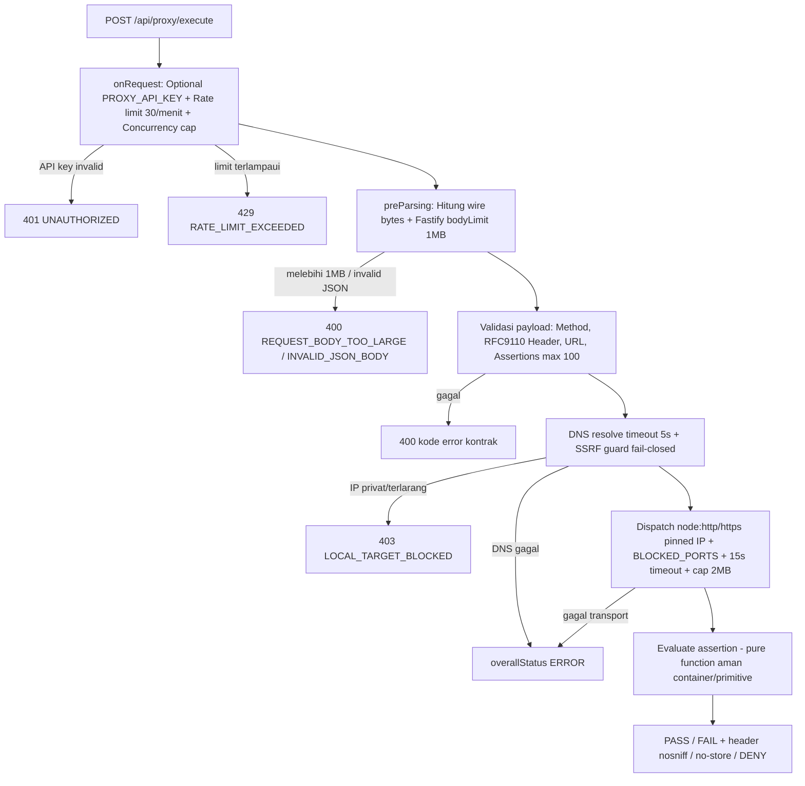

# ACF API Testing Tool — Backend

Backend proxy `POST /api/proxy/execute` untuk tool pengujian API satu-endpoint. Stack: Fastify 5 + TypeScript, Node 24.

> [!note] Cakupan & Status
> Backend berdiri sendiri, telah melalui hardening keamanan, dan dibuktikan lewat **155/155 unit & integration test** (`npm test`), `npm run typecheck`, dan `npm run build` (`dist/`). Frontend Workbench (`Astro + React + Tailwind`) juga sudah terimplementasi penuh di `frontend/`.

## Pipeline (`onRequest` → `preParsing` → Handler → Pure Evaluator)

## Keputusan teknis & hardening utama

| Topik | Aturan final | Bukti / Lokasi |
| --- | --- | --- |
| Timer latency | **Mencakup DNS** | `backend/src/api/proxy.routes.ts` & `docs/02` §1 |
| Reason path hilang | Satu string `path tidak ditemukan` untuk semua operator | `backend/src/core/assertion/evaluate.ts` & `docs/04` §2 |
| HTTP client & DNS rebinding | `node:http` / `node:https` langsung (`agent: false`) dengan custom `createPinnedLookup` ke IP hasil `checkTarget()`, mempertahankan hostname untuk TLS SNI | `backend/src/services/dispatcher.ts` |
| Pre-parse DoS guard | Rate limit, concurrency cap (`MAX_IN_FLIGHT_REQUESTS`), & `FASTIFY_BODY_LIMIT_BYTES=1MB` dievaluasi sebelum `JSON.parse` | `backend/src/api/proxy.routes.ts`, `backend/src/app.ts` |
| SSRF fail-closed | Malformed IPv4/IPv6 ditolak, `%zone` dibersihkan, `::ffff:0:0/96` (`0xffff`), NAT64, Teredo, 6to4, multicast/reserved diblokir, DNS lookup dibatasi 5s | `backend/src/services/ssrfGuard.ts` |
| Assertion crash safety | `TYPE_OPERATORS` memakai `Map`; `expectedValue` wajib primitif finite; `safePrimitiveString` cegah HTTP 500 pada `{toString: null}` | `backend/src/services/validator.ts`, `evaluate.ts` |
| DNS gagal | `overallStatus: "ERROR"` dengan pesan tersanitasi | `backend/src/services/ssrfGuard.ts` & `docs/04` §3 |
| Cap 2MB vs timeout | Dua kondisi terpisah (stream dihancurkan segera saat >= 2MB dengan `truncated: true`) | `backend/src/services/dispatcher.ts` |

> [!warning] Aturan Emas Keamanan
> Tidak ada penyimpanan payload/header request di server maupun `localStorage`, header hop-by-hop/forwarding/`Proxy-*`/`Accept-Encoding` di-strip, port layanan terbatas (`BLOCKED_PORTS`, termasuk port 22) diblokir, dan URL ber-userinfo ditolak sebelum dispatch.

## Tautan

- Desain: `docs/superpowers/specs/2026-11-18-backend-proxy-design.md`
- Kontrak: `docs/03-api-contracts.md`
- Semantik asersi: `docs/04-assertion-engine-spec.md`
- Scope v1.5: `requirement/PRD_API_Testing_Tool_v1.5_Final.md`
